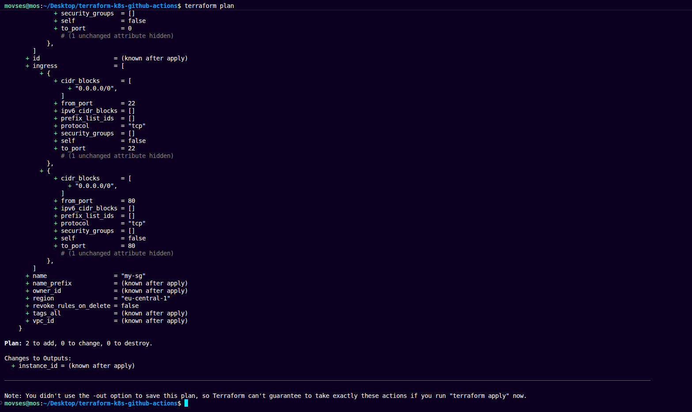
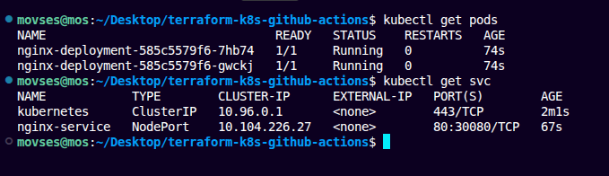
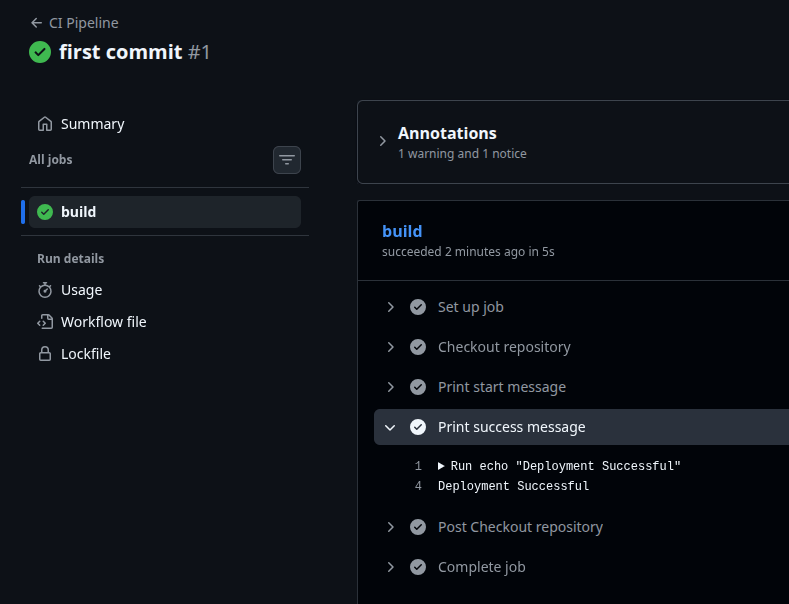

Terraform · Kubernetes · GitHub Actions

---

## Task 1 — Terraform

Created an AWS EC2 instance (`t3.micro`) using a variable for the region and an output for the instance ID. Validated with `terraform init` and `terraform plan` (no resources were created).



---

## Task 2 — Kubernetes

Deployed 2 Nginx replicas and exposed them via a NodePort Service (port 80). 



---

## Task 3 — GitHub Actions

Created a CI workflow (`.github/workflows/ci.yml`) that triggers on pushes to `main`, checks out the repo, and prints the required messages.



---

## Repository Structure

```text
devops-homework/
├── main.tf
├── variables.tf
├── outputs.tf
├── deployment.yaml
├── service.yaml
├── README.md
├── .gitignore
├── screenshots/
│   ├── 01-terraform-plan.png
│   ├── 02-kubernetes-pods.png
│   └── 03-github-actions.png
└── .github/workflows/
    └── ci.yml